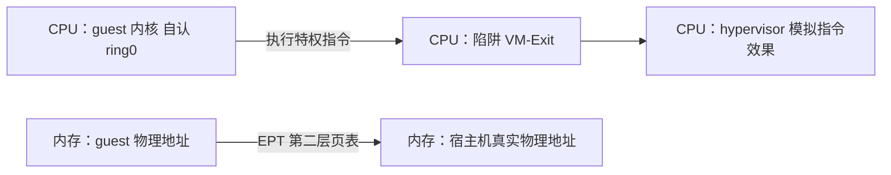

# 虚拟化的本质

一个 OS 内核要运行，需要 ring0（执行特权指令）+ 独占硬件（内存、中断、设备）。虚拟化 = 让多个内核各自以为自己是唯一老大。hypervisor 就是那个「骗子」。

## 两张欺骗

### 欺骗一：CPU 特权级（降权 + 陷阱）

- guest 内核**不在真正的 ring0 上跑**：经典做法是降到 ring3；现代做法是 VT-x 的「非根模式」。
- 它一执行特权指令（`cli` / `mov cr3` …），CPU 就**陷阱**（trap / **VM-Exit**），控制权交回 hypervisor。
- hypervisor 再**模拟**指令效果：guest 想 `cli`，不真关中断，只在数据结构里记「这个 guest 以为中断关了」。

> [!warning] 关键区分
> 「打桩」的对象是**特权指令**，不是系统调用。guest 内核干特权活靠特权指令，不是 syscall。

### 欺骗二：内存（嵌套页表 EPT）

- 进程隔离：虚拟地址 →（四级页表）→ 物理地址。
- guest：guest 物理地址 →（第二层页表 **EPT**）→ 宿主机真实物理地址。两层套娃。

## 一个历史坑（为什么有 VT-x）

纯「降权到 ring3 + 陷阱」在 x86 上不完整：早期有些敏感指令在 ring3 下不 trap，而是静默失败。所以 Intel / AMD 把硬件虚拟化扩展（VT-x / AMD-V）做进 CPU，让 trap 由硬件自动、一个不漏——即「根模式（VMM）vs 非根模式（guest）」。

## 软件路子（打桩 / 半虚拟化）

把特权指令「打桩成用户级接口再转发」是一种可行老路子，但要么慢（逐条模拟），要么要改 guest 代码（半虚拟化）。硬件方案 VT-x 既不用改 guest，又能全量捕获。