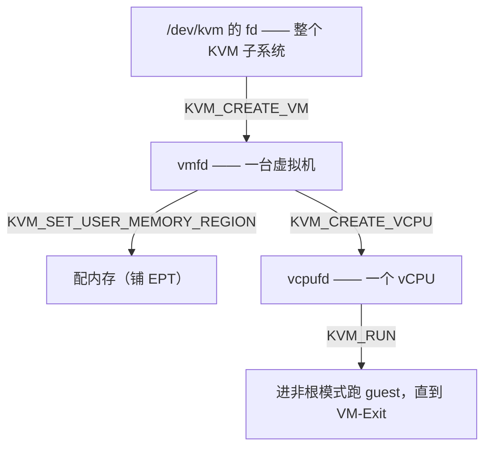

# KVM 原理 · 设备节点与 ioctl 生命周期

核心问题：用户态的 Firecracker / QEMU，怎么指挥内核里的 KVM 干活？

## 接口形态：/dev/kvm + ioctl

- `/dev/kvm` 是一个**字符设备节点**：不收发数据，只接收命令。
- 第一步 `open("/dev/kvm")` 拿到 `kvmfd`，之后所有操作都靠 `ioctl` 下命令。

### ioctl 是什么

**ioctl = input/output control（输入/输出控制）**。设备要"下指令"而非"传数据"，就走 `ioctl(fd, 命令号, 参数指针)`。

## 三层 fd 层层嵌套

KVM 把「虚拟化对象」也抽象成文件描述符，一层套一层：



| fd | 代表 | 装了什么 |
|---|---|---|
| `kvmfd` | 整个 KVM 子系统 | 全局唯一入口 |
| `vmfd` | 一台虚拟机 | 内存、EPT 根、vCPU 共享状态 |
| `vcpufd` | 一个 vCPU | 独立的一份 CPU 寄存器 + 一个 VMCS |

一台 VM 配几个 vCPU，就 create 几个 `vcpufd`，每个将来对应一个线程——「vCPU = 线程」在 API 层落地。

## 生命周期四步

```c
int vmfd   = ioctl(kvmfd, KVM_CREATE_VM);              // ① 建 VM
ioctl(vmfd, KVM_SET_USER_MEMORY_REGION, &region);      // ② 配内存 = 铺 EPT
int vcpufd = ioctl(vmfd, KVM_CREATE_VCPU, 0);          // ③ 建 vCPU
ioctl(vcpufd, KVM_RUN);                                // ④ 跑起来，阻塞到 VM-Exit
```

1. `KVM_CREATE_VM`：内核分配一台 VM 的数据结构，返回 `vmfd`，尚无 CPU。
2. `KVM_SET_USER_MEMORY_REGION`：登记「guest GPA 区间 ↔ 宿主用户态内存 HVA」的映射。用户态进程碰不到 HPA，所以它传的是自己 `mmap` 出来的虚拟地址 HVA；内核再查**宿主进程页表**把 HVA→HPA，最终铺成 EPT 的 GPA→HPA。**本质铺 EPT**，但中间夹了一层 HVA。
3. `KVM_CREATE_VCPU`：建好 VMCS、初始化寄存器，返回 `vcpufd`。
4. `KVM_RUN`：vCPU 跑起来，**阻塞**直到一次 VM-Exit。

## 核心：Run 循环（VMM 的本质）

QEMU / Firecracker 的本质 = 一个死循环：

```c
for (;;) {
    int ret = ioctl(vcpufd, KVM_RUN);   // 阻塞，进 guest 跑，直到 VM-Exit
    if (ret 是设备 I/O) 模拟设备、修状态;   // 例如把“写磁盘”真的写进文件
    // 回到顶，再 KVM_RUN 还权给 guest
}
```

Firecracker 的全部魔法 = 这个循环 + 极简设备模拟。

参见 [[01-虚拟化的本质]]、[[02-EPT与VT-x]]、[[03-Type1与Type2-KVM与QEMU]]。