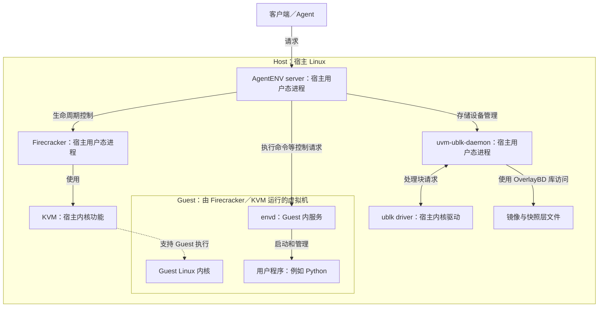

# AgentENV 系统地图与第 1 课：谁在哪里

关联：[学习计划](00-学习计划.md) · [学习记录](学习记录.md) · [源码索引](源码索引.md) · [第 2 课：指针属于谁](02-指针属于谁.md)

## 本次先看三个对象

```text
宿主 Linux（Host）
  ├── AgentENV server 进程：管理沙箱
  └── Firecracker 进程：借助 KVM 运行虚拟机
                         └── Guest Linux
                               └── 用户程序
```

这是位置示意，不是可以用宿主 `ps` 展开的原生父子进程树。Guest 是一套虚拟机执行环境；Guest 内的程序由 Guest 内核管理。Firecracker 自身则由宿主内核作为宿主进程管理。

“运行在虚拟机里”和“运行这台虚拟机”是两个位置：用户 Python 程序属于前者，Firecracker 属于后者。

### 用源码检查，不只记图

固定版本 `instance.rs` 中有以下证据，按顺序阅读即可：

| 证据 | 表示什么 | 不能据此推断什么 |
|---|---|---|
| 导入 `tokio::process::{Child, Command}` | 使用宿主进程管理接口 | 仅导入类型不证明已经启动进程 |
| `Command::new(&firecracker_binary)` | 准备要启动的可执行文件与参数 | 这一步本身尚未启动程序 |
| `spawn_tokio_command_scoped(...)` 返回 `child` | 真正启动并取得子进程句柄 | 这里的 child 不是 Guest 内的用户程序 |
| 保存 `self.process = Some(child)`，之后读取 `child.id()` | 保存 Firecracker 的宿主进程句柄，能取得宿主 PID | 此 PID 不等于 Guest 内某个 Python 的 PID |

这里还有一个容易被名称误导的对象：`FirecrackerInstance` 是 server 里的 Rust 结构体，它保存控制连接、路径和进程句柄。这个对象与被启动的 Firecracker 进程不是同一个东西。

```text
server 地址空间内：FirecrackerInstance 对象
                         │ 保存句柄与连接信息
                         ▼
独立宿主进程：       Firecracker
```

理解这一点后，读到 `self.fc_instance.pause()`，应先理解为 server 调用自己的管理对象，由该对象向 Firecracker 发出请求。函数名本身不意味着调用者已经进入 Guest 执行代码；请求细节在后续课展开。

### 纸面练习

以下 PID 全为课堂假设，不是服务器实测：

```text
宿主看到：server PID = 1000，Firecracker PID = 2000
Guest 内看到：Python PID = 17
server 保存的 child.id() 返回 2000
```

迁移题：**能把 `child.id()` 返回的 2000 当作 Guest 内 Python 的 PID 吗？请说明这两个 PID 分别由哪边内核管理。**

本轮只需回答这一问。完整地图和后续题留作课程导航；用户作答前，代码证据和教师解释均不算用户独立验收。

## 先用六组职责定位

这六组是学习视角，不是必须依次穿过的六层协议，也不是六个独立进程。

| 组 | 负责的问题 | 主要对象 |
|---|---|---|
| 请求与管理 | 谁接收请求，怎样创建/暂停/销毁 | 节点 API、orchestrator、server |
| Guest 内执行 | 谁真正执行用户命令 | Guest Linux、envd、用户程序 |
| 虚拟机运行 | 谁让 Guest 指令运行，谁模拟设备 | Firecracker、KVM、vCPU/VMM 线程 |
| 存储 | 磁盘与内存镜像的数据从哪来 | OverlayBD、ublk daemon、ublk driver、层文件 |
| 网络与隔离 | 包怎样出去，权限与资源怎样限制 | 虚拟网卡、TAP、namespace、cgroup、seccomp |
| 状态与恢复 | 怎样保存和重建一个执行环境 | VM 状态、内存层、磁盘层、快照管理与恢复流程 |

快照会跨越多组；读代码时要跟着具体请求走。多节点 gateway/scheduler 在第 25 课补入，第一课先聚焦一台 Host 和一台 microVM。

## 进程位置图



图中的框表示执行环境与对象位置，实线是简化职责关系，虚线不是内存数据路径。Guest 并非一棵可以用宿主普通 `ps` 直接展开的原生进程子树。这张图也未展开 virtio、设备 IO 与恢复内存读取，后续分别画。

## 第 1 课只解决三个认识

1. Host 是运行 AgentENV 节点的宿主 Linux；Guest 是虚拟机内部的 Linux。两边都有各自的内核视角与进程。
2. Firecracker 是 Host 上的程序。它借助宿主 KVM 和硬件运行 Guest；Guest 里的 envd 与 Python 是另一侧的进程。
3. server 和 Firecracker 是不同的宿主进程。server 中的一个 Rust 对象或 trait 不等于一个额外进程；OverlayBD 也不能仅凭名称被认定为独立进程。

与源码对应：`FirecrackerInstance` 使用 `tokio::process::Command` 启动 Firecracker，并保存 `Child` 和 PID；这给出了 Firecracker 是宿主进程的直接实现证据。具体片段在 [instance.rs](https://github.com/kvcache-ai/AgentENV/blob/9f62cbe07cebfecf416dc9bdcf497e2a97687644/src/sandbox/firecracker/instance.rs)，查找 `spawn_with_netns`、`Command::new`、`pid`。

## 入门诊断题

**Firecracker 进程运行在 Host 还是 Guest？请用自己的话说理由。**

此题检查基本位置判断；本页顶部的 PID 场景用于进一步检验。此题已给出材料，因此回答一次不代表独立掌握。

## 后续验收题，教学时逐题展开

- 用户说“我的 Python 在沙箱里运行”，这里的 Python 在图中哪个位置？谁负责启动它？
- server 调用一个 Rust 函数时，是否自动产生一个新进程？需要什么证据才能判断？
- 在宿主机看到 Firecracker PID，能否直接把它当作 Guest 内 Python 的 PID？
- 读到一个新组件时，先判断它是进程、线程、库、内核功能、设备还是文件，再说明它所在的位置。

学习产物：一张用户自己画的位置图，以及对上述对象的分类。尚未收到回答，不标记通过。

依据：[固定版本架构说明](https://github.com/kvcache-ai/AgentENV/blob/9f62cbe07cebfecf416dc9bdcf497e2a97687644/docs/src/internals/architecture.md)。图为教学简化，不代表服务器安装版本已核验。
