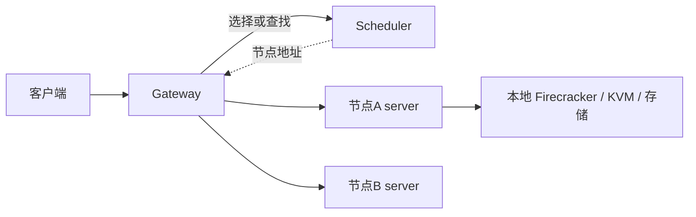

# 第25课：多节点与资源池

2026-11-16 第一轮。依据固定AgentENV提交 `9f62cbe07cebfecf416dc9bdcf497e2a97687644` 的架构文档核对组件职责、路由绑定与预热资源。未逐行审计gateway/scheduler/pool源码，无集群实验；并发分配与容量例子均为通用设计推演，不声称该版本实现了容量感知或原子预留。

## 1. 从一台机器扩展到多台

本课节点指运行AgentENV节点server和沙箱运行环境的宿主侧实例。教学例中A/B各一台Linux宿主机。gateway接收并转发请求，scheduler选择新沙箱节点或查找已有沙箱归属，节点server负责真正的本地创建/恢复/运行。

Scheduler不执行每次Guest指令，也不负责每次Guest内存翻译。固定文档说明默认选节点策略为round_robin，也可random；不能把“有scheduler”理解成已经按CPU/内存和模板缓存智能选择。

## 2. 新创建与访问已有沙箱

新建：gateway调用Schedule取得目标节点，将创建请求转发过去；创建成功后RecordAssignment建立sandbox ID到node的绑定。已有实例：按ID LookupNode，再转发到其所在节点。普通已有实例请求不能任意轮询到其他节点；另一台机器有空闲FC进程也不意味着已有那份Guest运行状态。

示例：sandbox-42在A，后续exec路由到A。不能因为B较空就直接把同ID的exec发给B。跨节点迁移/从快照重建需要转移可恢复材料、关联运行状态与路由，不是改映射表一项就完成。

## 3. 资源池究竟提前准备什么

| 池/缓存 | 提前准备 | 不能由此直接推出 |
|---|---|---|
| 网络槽位池 | 本地网络相关资源 | Guest服务已经就绪 |
| Firecracker池 | 固定文档描述预启动FC与网络slot成对准备 | 目标快照已装载、全部RAM驻留 |
| 块设备预热池 | 与镜像/大小相关的可复用设备 | 任意模板/规格都可用同一条目 |
| 数据缓存 | 某些镜像或页内容 | 所有恢复步骤已经完成 |

预热把部分准备工作移到请求到来之前，不消灭工作和资源成本。池条目必须与模板/大小/网络/状态等要求匹配。完整可运行VM池与空FC进程池不是同一层级，收益与保留成本也不同。

## 4. 两种容易误判的成功

取到FC条目后，仍可能要准备磁盘、装载VM状态、关联RAM后端、补配置并等待envd。资源ready、恢复完成和第一条业务命令完成分开计时。

通用并发场景：池里只有1条可分配资源，X/Y同时请求。先查count=1再各自分配会重复出借，需原子取得/认领。运行中节点容量也会被并发请求消耗，过期观测不是即时容量保证。此处是设计边界，未核实本版具体分配锁/预留实现。

## 5. 心跳、绑定与节点故障

心跳是节点定期向控制服务报告状态的消息。固定文档描述节点上报沙箱ID名单，scheduler据此更新归属；绑定在内存，scheduler重启后需由新创建与后续心跳等重建。绑定TTL表达路由新鲜度，不等于沙箱执行超时。

查不到路由不证明VM已死，心跳中断也可能是网络故障。反过来，节点不可用时，另一节点即使有预热进程，也不能凭空恢复尚未持久化的RAM和外部业务状态。

## 课末自测

1. sandbox-42在A，B更空且有空闲FC，能否直接把下一条exec轮询到B？
2. 从FC池取得条目，能否断言首条Guest命令立即成功？还差什么？
3. scheduler重启丢了绑定，能否断言所有Guest已退出？怎样重新确认归属？

来源：[固定架构文档的Distributed Control Plane与Sandbox Networking](https://github.com/kvcache-ai/AgentENV/blob/9f62cbe07cebfecf416dc9bdcf497e2a97687644/docs/src/internals/architecture.md)。第26课继续模板、持久化与fork。
