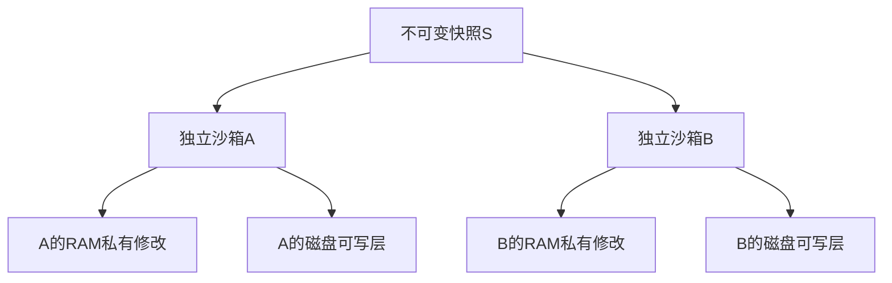

# 第26课：模板、持久化、fork与Agent状态

2026-11-16 第一轮。关联[第18课](18-从快照恢复.md)、[第25课](25-多节点与资源池.md)。固定AgentENV基线 `9f62cbe07cebfecf416dc9bdcf497e2a97687644`。本轮实际核对架构文档对snapshot/template职责、不可变层与内存恢复的描述；snapshot/mod.rs和template/mod.rs原文抓取未成功，不声称完成逐函数审计。以下fork是“从同一状态产生多个独立沙箱”的概念模型，不宣称对应某个已核对API或Linux fork调用。无真实构建/跨节点恢复实验。

## 1. 模板、快照与运行实例

教学场景：Python与依赖已安装，服务完成初始化，希望接到请求时快速生成独立环境。

- 运行实例有进程、RAM、设备与网络等活状态。
- 快照记录一个可恢复的状态点，需要配套VM状态、RAM逻辑镜像、磁盘视图与恢复配置，不保证外部系统一起回滚。
- 模板是供后续重复创建环境使用的发布入口/配方。在AgentENV固定文档里template builder会发布已提交快照；其他平台模板可能只有磁盘镜像，不能推广为所有模板必含RAM。
- 预热池是已经准备到某一阶段、等待领取的运行时资源；缓存是可能加速取数的本地副本，均不能代替持久化的恢复材料。

## 2. 从同一底座生成A/B

这里fork描述逻辑分支，不能直接等同于复制宿主Firecracker进程；实际创建可能走快照恢复。只读快照层可以复用。同一Host下能否共享物理页/页缓存依实际映射和版本；跨机器通常是各自取得数据，不是两台机器直接共用同一物理页。配套FC具体映射仍待核验。

假设S中内存x=10、私有根盘文件内容为old。A将x改20并把该文件改为A-new，在B未另行修改且两实例各自私有写入的前提下，B仍读10/old，S也不应被改。RAM依COW等私有化机制，磁盘依独立可写层，二者并非同一份dirty位图。若另挂同一外部可写盘/数据库，则要按共享资源契约讨论，不能套“完全互不影响”。

## 3. 本地能恢复与持久化发布

| 阶段 | 已说明什么 | 尚未保证 |
|---|---|---|
| RAM/层数据在buffer | 字节已读到本地内存 | 文件完整、可持久恢复 |
| 本地临时文件 | 有部分/全部输出 | 层完整、VM状态与父层配套 |
| 节点A本地可恢复 | A能取得当前所需材料 | A故障后仍可恢复、B能访问 |
| 按仓库契约提交发布 | 材料及元数据按相应存储契约可取得 | 任意节点兼容、权限可用、零取数开销 |

持久化仓库可以是本地POSIX或远端存储，故“已持久化”不自动等于“任意节点可访问”。跨节点恢复需取得状态文件、RAM/磁盘层及所有父引用，验证兼容与完整性，再建立当地设备/网络/进程。缓存命中可省下载，缓存丢失后应能回到受支持的权威来源；若只有缓存保存唯一副本，就不能随意删除。删除父层前应确认无依赖或已按正确合并/重写形成独立可恢复视图。

## 4. 恢复VM与复制Agent任务

假设快照里Agent正准备向外部服务执行任务42。从同一状态生成A/B，两份内存都可能认为自己应继续做42。VM隔离保证私有修改不直接互相覆盖，不保证业务只执行一次。需要按业务设计新实例身份、外部原子认领、幂等键或明确的分支任务。已有连接、外部数据库、共享卷、租约也不会自动跟VM分支或回滚。

## 自测

2026-11-16 答题补充：外部共享文件变化，不会自动把另一个进程此前read到用户buffer的字节改掉。后续重新读取可能看见新内容，但是否立即可见取决于共享存储的缓存、一致性与同步语义。A已恢复且若干页已驻留，也不证明其余按需页或未来重新恢复无需父层；删除父层需先形成独立完整视图并核对所有引用。三题判断正确，用户已解释父层依赖，未做实测。

1. A/B从S创建，A修改私有RAM和根盘文件，B及S是否应跟着改变？如果文件位于同一个外部可写共享盘，结论是否相同？
2. A本地恢复测试成功，就能删除所有父层并保证B异机恢复吗？分别缺少什么条件？
3. 快照里的Agent下一步是给外部counter加1，生成A/B后能仅靠COW保证只加一次吗？

来源：[固定AgentENV架构文档](https://github.com/kvcache-ai/AgentENV/blob/9f62cbe07cebfecf416dc9bdcf497e2a97687644/docs/src/internals/architecture.md)，第13—18、23课已归档机制。下次进入第27课六条完整链路，综合检查角色、地址、字节、通知、资源寿命和完成边界。
