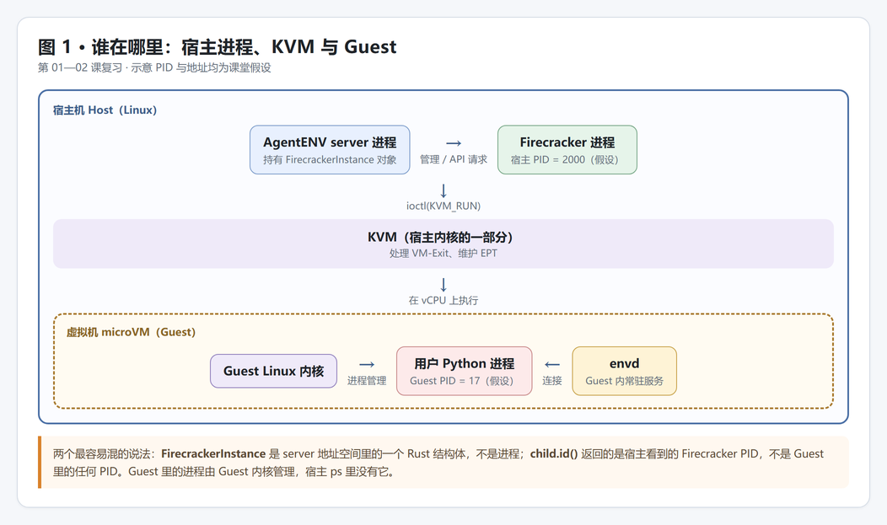
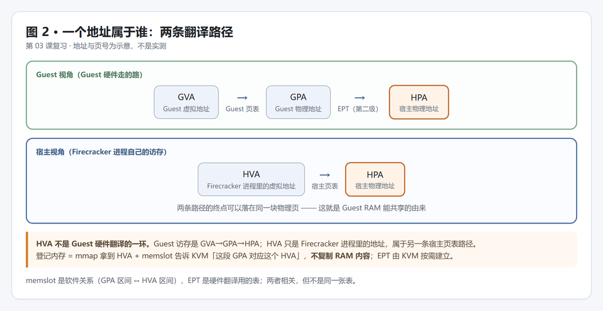
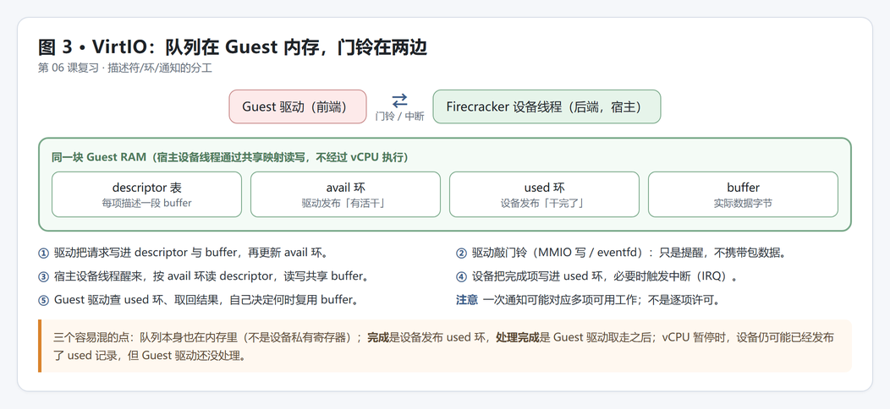
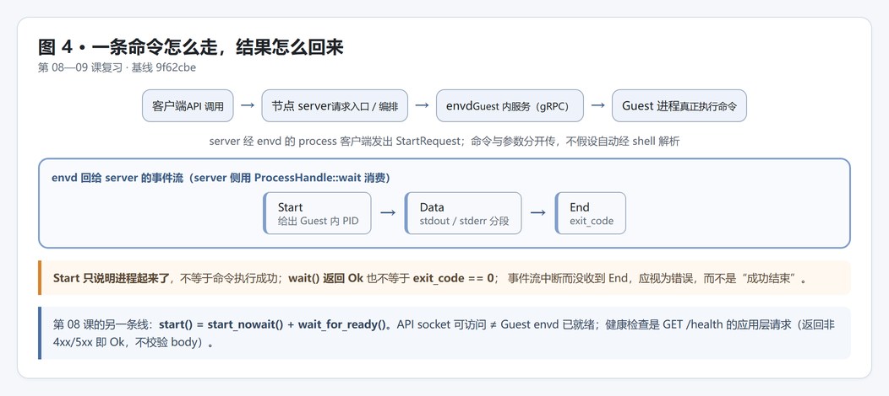

# 复习图示：第 01—09 课

2026-10-30。这是一页**复习索引**，不是新课程，也不改变验收状态（独立验收仍为 0/28）。
四张图对应：位置（01—02）、地址翻译（03）、VirtIO 通知（06）、exec 事件流（08—09）。图片在 `assets/`。

## 图 1 · 谁在哪里



一张图里只有三个执行主体：server 进程、Firecracker 进程、Guest（由 Guest 内核管理）。KVM 属于宿主内核；`FirecrackerInstance` 是 server 里的结构体，`child.id()` 拿到的是宿主 PID。

## 图 2 · 一个地址属于谁



Guest 访存是 GVA→GPA→HPA（Guest 页表 + EPT）；HVA 是 Firecracker 进程里的地址，走宿主页表，不是 Guest 硬件翻译的一环。登记内存（mmap + memslot）不复制 RAM 内容，EPT 按需建立。

## 图 3 · VirtIO 的队列与通知



描述符表、avail 环、used 环都在 Guest 内存里；门铃只是提醒，不携带数据；设备发布 used 表示设备归还结果。Guest 驱动读取完成项、继续处理数据和应用处理结束仍是不同阶段，不能把“取走记录”当作所有处理都已完成。

## 图 4 · 一条命令怎么走



server → envd（gRPC）→ Guest 进程；回来的是 Start / Data / End 事件流。Start 只表示进程已启动，`wait()` 返回 Ok 也不等于 `exit_code == 0`。

## envd 通信（文本链路）

```text
Firecracker 进程启动
    ↓
宿主侧 API socket 可用          ← 只说明 VMM 能接收控制命令
    ↓
microVM 启动，Guest 内核开始运行
    ↓
Guest 内 envd 启动，监听 eth0 的 control_plane_port
    ↓
server 构造 base URL：http://{guest_ip}:{port}
    ↓
TCP 握手成功（网络通）
    ↓
GET /health 返回非 4xx/5xx
    ↓
server 认为 envd 就绪，可以下发命令
```

```text
server 发 StartRequest（gRPC process.start）
    ↓
包穿过：宿主 netns/tap0 → Firecracker virtio-net → Guest eth0
    ↓
envd 在 Guest 内创建进程
    ↓
envd 回 Start 事件（Guest PID）
    ↓
进程运行，stdout/stderr 以 Data 事件流式回传（可能 0..n 条）
    ↓
进程退出，envd 回 End 事件（exit_code）
    ↓
server 的 wait() 返回，检查 exit_code
```

两条通道别混：宿主↔Firecracker 走 Unix socket（`--api-sock`），宿主↔envd 走 TCP（virtio-net）。API socket 能连上，不等于 envd 已就绪。

## 容易说错的对照表

| 容易说成 | 应该说 |
|---|---|
| FirecrackerInstance 就是 Firecracker 进程 | 它是 server 地址空间里的结构体，保存句柄与连接 |
| `child.id()` 是 Guest 里 Python 的 PID | 是宿主看到的 Firecracker PID |
| Guest 访存：GVA→GPA→HVA→HPA | Guest 访存：GVA→GPA→HPA；HVA 是另一条宿主路径 |
| 访问到 HPA 就等于“回到宿主” | 映射有效且权限允许的普通 RAM 访问可由硬件完成；缺失映射、权限等条件仍可能导致退出 |
| VM-Exit 就等于回到 Firecracker 用户态 | 先回宿主内核，KVM 能处理就直接处理再重入 |
| 设备完成 = Guest 已处理完成 | used 表示设备完成；Guest 驱动和应用后续处理还需执行 |
| eventfd / 门铃携带包数据 | 提醒查队列；descriptor 描述缓冲区，包字节在 buffer 里 |
| Start 事件 = 命令执行成功 | 只表示启动；成功要看 End 的 exit_code 且 wait 正常返回 |
| API socket 可用 = 环境就绪 | 还要 envd 健康检查（GET /health）通过 |
| server 与 envd 也走 Firecracker API socket | 走 TCP（virtio-net）；API socket 是另一条独立通道 |

## 下一步待答

1. 第 09 课原题：拿到 Start 事件和 PID，能否确认 `hello.py` 执行成功？
2. 复习题：Guest 里一条普通 load 指令，数据最终在 HPA 上，这条指令会导致 VM-Exit 吗？为什么？

相关：[学习记录](学习记录.md) · [28 课计划](00-学习计划.md) · [源码索引](源码索引.md)
