# AgentENV 图解复习手册

更新：2026-11-13。覆盖第1—24课与冷热/脏页专题，配套 [68页图解PPT](复习-AgentENV图解增强版.pptx)。

> 阅读顺序：先看图并尝试复述，再看机制说明，最后展开自测答案。PPT备注中也有详细解释与来源。材料完善不代表独立掌握；第25—28课仍按学习计划继续。

## 证据与适用范围

- AgentENV 源码基线为 `9f62cbe07cebfecf416dc9bdcf497e2a97687644`。通用Linux机制与具体项目选择分开理解。
- 地址、页号、请求编号和多数时间线均为课堂假设。第52页的数据来自此前教师本地Windows/Node实验，不是microVM或DSA实测。
- 恢复内存以固定基线文档的私有映射/COW模型说明；尚未重新审计配套Firecracker底层映射，不能把共享page cache或匿名页模式当成部署定论。
- 完整读例采用split virtqueue、传统ublk交接以及选定的io_uring后端READ，不声称所有内核版本和后端都采用相同接法或复制次数。

## 按问题定位

| 主题 | PPT页码 | 课程详解 |
|---|---|---|
| 系统角色与三条路径 | 3、4 | [01-系统地图与第一课](01-系统地图与第一课.md) |
| 地址空间、memslot与跨进程读取 | 5、6、7、8 | [03-Guest内存与宿主映射](03-Guest内存与宿主映射.md) |
| KVM_RUN、TLB与暂停 | 9、10、11 | [04-Guest指令执行](04-Guest指令执行.md) |
| VirtIO描述符、环与通知 | 12、13、14、63 | [06-VirtIO描述符队列与通知](06-VirtIO描述符队列与通知.md) |
| 设备准备与就绪 | 16、62 | [08-启动与就绪](08-启动与就绪.md) |
| 控制请求与命令事件流 | 15、17 | [09-命令执行与事件流](09-命令执行与事件流.md) |
| 完整Guest文件读取与SQ/CQ | 18、19、20、21、22、64 | [12-ublk与存储daemon](12-ublk与存储daemon.md) |
| OverlayBD层、索引和零覆盖 | 23、24 | [11-OverlayBD层与索引](11-OverlayBD层与索引.md) |
| mmap、缺页与COW | 25、26、27 | [13-mmap缺页与COW](13-mmap缺页与COW.md) |
| 快照材料、完成边界与一致性 | 28、29、30、68 | [14-快照状态与一致性](14-快照状态与一致性.md) |
| 冷热、脏页跟踪与EPT | 31、32、33、34、35、65、66 | [15a-冷热页与脏页跟踪](15a-冷热页与脏页跟踪.md) |
| pause捕获、chunk与buffer | 36、37、38 | [17-chunk写出与快照封存](17-chunk写出与快照封存.md) |
| 层格式、封存与持久化 | 39 | [17-chunk写出与快照封存](17-chunk写出与快照封存.md) |
| 恢复、按需加载与外部状态 | 40、41、42 | [18-从快照恢复](18-从快照恢复.md) |
| 网络包与发送完成 | 43 | [19-网络包怎样出去](19-网络包怎样出去.md) |
| 隔离机制的作用对象 | 44 | [20-各种隔离分别限制什么](20-各种隔离分别限制什么.md) |
| 资源拥有、回收与寿命 | 45、46 | [21-资源拥有与回收](21-资源拥有与回收.md) |
| async、线程阻塞与取消 | 47、48、67 | [22-async与并发](22-async与并发.md) |
| 结果未知、幂等和重试 | 49、50 | [23-失败与恢复](23-失败与恢复.md) |
| 性能度量与公平实验 | 51、52、53、54、55、56、57 | [24-性能指标怎样读](24-性能指标怎样读.md) |
| 综合推演与下一步 | 58、59、60、61 | [学习记录](学习记录.md) |

## 01 系统角色与三条路径

对应PPT：3、4页。深入阅读：[01-系统地图与第一课](01-系统地图与第一课.md)。

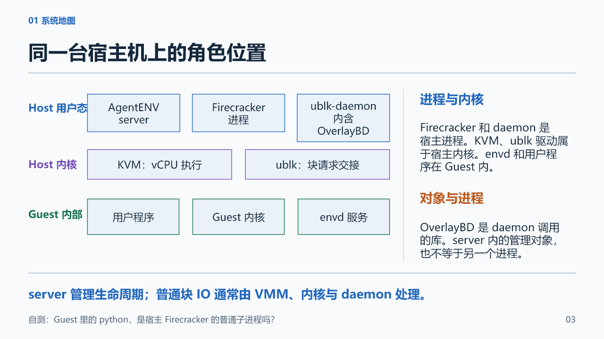

### 同一台宿主机上的角色位置

**server 管理生命周期；普通块 IO 通常由 VMM、内核与 daemon 处理。**

Firecracker和存储daemon都是宿主进程。KVM与ublk驱动属于宿主内核。envd在Guest内。OverlayBD是daemon调用的库，不必是独立进程。Guest进程由Guest内核管理，宿主ps不直接列出Guest进程。图中同一行仅表示位置，不表示强制串行调用。

### 三条路径分别承载什么

**控制请求、Guest 磁盘 IO、Host 内存捕获是三条不同路径。**

server会准备设备、保存句柄和控制生命周期，不应因此被画成每一次普通Guest磁盘读取的payload中转者。内存快照跨进程读取由server执行，使用自己的本地buffer。恢复内存后端的Host块读取又不同于Guest磁盘VirtIO路径。

自测与参考答案

**第3页：Guest 里的 python，是宿主 Firecracker 的普通子进程吗？**

不是。它由Guest内核管理；宿主主要看到VMM的进程与vCPU等线程。

**第4页：保存 Guest RAM 一定要先让 Guest 发布 VirtIO 描述符吗？**

不一定。本课PVM捕获在宿主执行，不依赖Guest VirtIO。

## 02 地址空间、memslot与跨进程读取

对应PPT：5、6、7、8页。深入阅读：[03-Guest内存与宿主映射](03-Guest内存与宿主映射.md)。

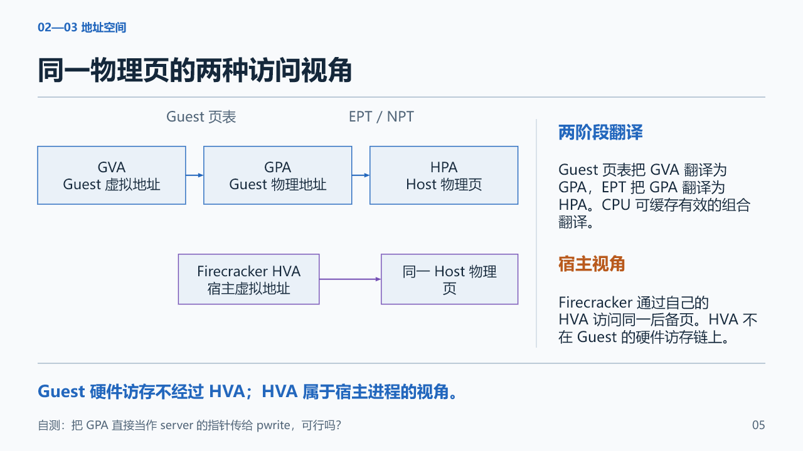

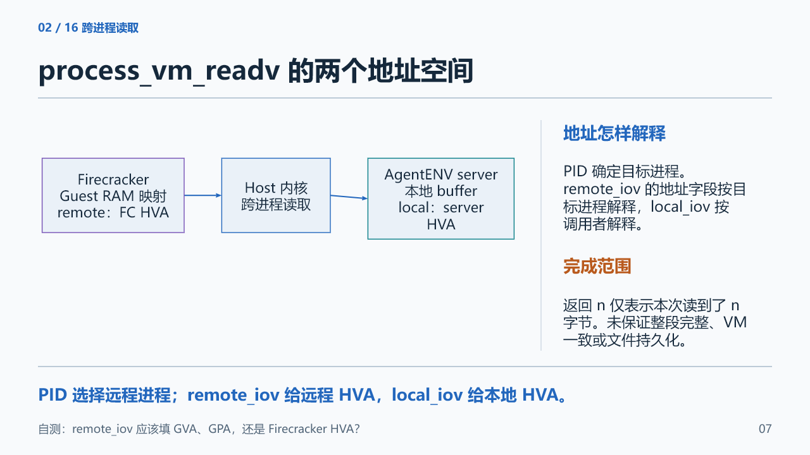

### 同一物理页的两种访问视角

**Guest 硬件访存不经过 HVA；HVA 属于宿主进程的视角。**

GPA是Guest看见的物理地址，不是宿主DRAM位置。硬件第二阶段页表将GPA映射到HPA。Firecracker通过自己的宿主页表用HVA访问Guest RAM后备页。两种视角可访问同一物理页，不表示又复制了一份数据。

### memslot 登记的是一段对应关系

**KVM 用 GPA 范围与 Firecracker HVA 找后备页，不要求 VMM 填 HPA。**

偏移0x2120加到HVA基址得到0x70002120。KVM_SET_USER_MEMORY_REGION记录memslot。登记不等于提前触碰每一页、复制全部RAM或固定全部物理页。公式只适用于该连续区域且地址合法。

### process_vm_readv 的两个地址空间

**PID 选择远程进程；remote_iov 给远程 HVA，local_iov 给本地 HVA。**

Linux接口还包含local_iov元素数、remote_iov元素数和flags，不能把简化示意当成完整函数声明。成功返回的是实际复制字节数，可能短读；不是快照持久化保证。不能以“内核会翻译地址”推导普通write能解释其他进程指针。

### 短读后，源和目的都要前进

**成功复制部分字节，不代表整段读取完成，也不代表快照一致。**

实际循环需校验返回值、地址/长度溢出、零进展以及错误。内存可在多次读取之间变化，PVM不提供整个VM的一致性快照。async函数调用同步PVM不会自动把操作变成非阻塞；执行线程直到调用返回才回到运行时。

自测与参考答案

**第5页：把 GPA 直接当作 server 的指针传给 pwrite，可行吗？**

不可行。普通指针按调用者地址空间解释，GPA不是server HVA。

**第6页：登记完 memslot，能否断言所有 EPT 叶项都已建立？**

不能。后备页和映射可以按需准备。

**第7页：remote_iov 应该填 GVA、GPA，还是 Firecracker HVA？**

Firecracker HVA。PID与该地址共同定位远程进程内存。

**第8页：第一次短读后，能否只移动源地址、不移动目的地址？**

不能，否则后续字节会覆盖此前已读取的数据。

## 03 KVM_RUN、TLB与暂停

对应PPT：9、10、11页。深入阅读：[04-Guest指令执行](04-Guest指令执行.md)。

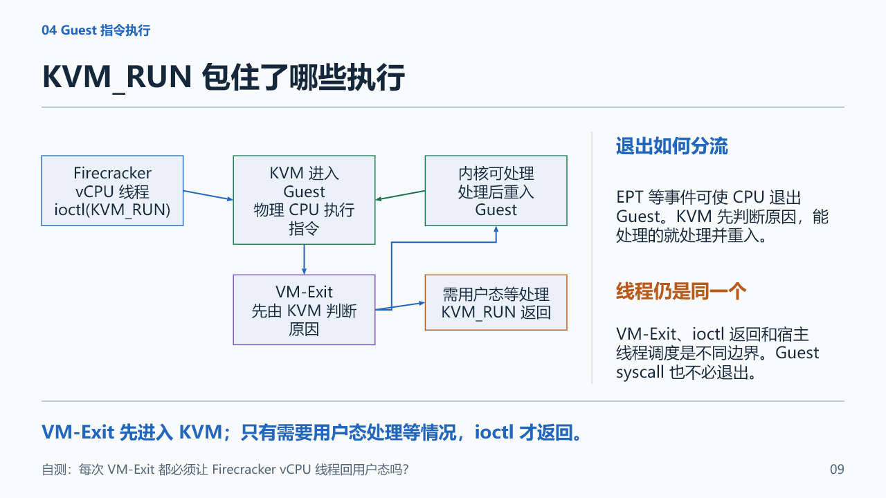

### KVM_RUN 包住了哪些执行

**VM-Exit 先进入 KVM；只有需要用户态处理等情况，ioctl 才返回。**

KVM_RUN是vcpu fd上的ioctl，调用者仍是宿主线程。进入Guest和返回Host不自动等于宿主调度切换。普通Guest syscall由Guest内核处理，不必退出；EPT权限/映射问题可能退出。ioeventfd可让KVM在内核处理通知并唤醒设备后端。

### TLB 缓存的是当前上下文的翻译

**TLB 未命中只要求重新查表；有效映射齐全时，不必 VM-Exit。**

在Guest执行上下文中，CPU可以缓存组合翻译及权限。不能把CPU想成先完成Guest地址翻译再把GPA“发到另一台Host CPU”。Guest与Host共享物理处理器的执行资源，虚拟化模式与标识用于区分上下文。页表更新还需按协议同步缓存。

### 暂停由多个执行角色共同完成

**暂停请求已送达、所有 vCPU 已停、快照已保存，是不同完成点。**

本页表达职责，不宣称每一版本使用相同信号和屏障实现。vCPU线程失去CPU调度不等于已按快照协议暂停。VMM设备处理代码可在宿主执行并访问Guest RAM，不要求Guest vCPU先执行。

自测与参考答案

**第9页：每次 VM-Exit 都必须让 Firecracker vCPU 线程回用户态吗？**

不必须，KVM能处理时可直接重入。

**第10页：Guest 页表允许写，是否足以保证最终可以写入？**

不足以，第二阶段权限等仍可能限制写入。

**第11页：vCPU 已暂停，能否据此断言 RAM 快照写盘成功？**

不能。捕获与写出是后续独立步骤。

## 04 VirtIO描述符、环与通知

对应PPT：12、13、14、63页。深入阅读：[06-VirtIO描述符队列与通知](06-VirtIO描述符队列与通知.md)。

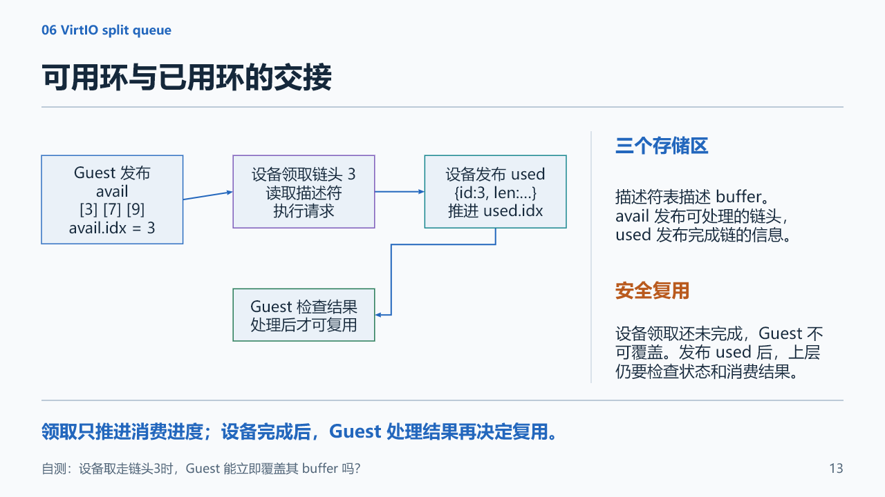

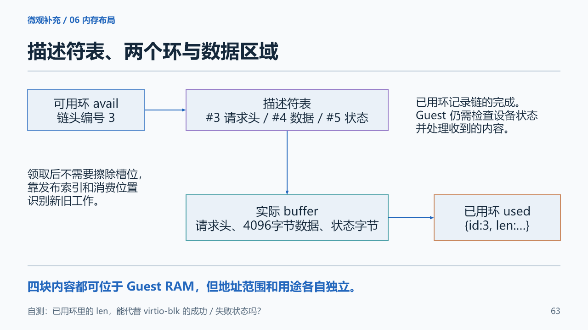

### 描述符描述 buffer，自己不搬数据

**addr 指向缓冲区，len 描述容量，flags 和 next 描述方向与链。**

这是未启用额外地址转换扩展的split virtio-blk读请求教学例。请求头含块操作和扇区位置，addr指内存，两者不能混。设备后端需检查并将GPA范围对应到Guest RAM宿主映射，不能把GPA直接当宿主指针。

### 可用环与已用环的交接

**领取只推进消费进度；设备完成后，Guest 处理结果再决定复用。**

队列取走条目通常不需要将槽清空，靠索引与各方消费位置区分新旧。两个环可在同一大分配中分区，并不意味着同一个环。used只提供完成记录，块设备状态还需检查。发布与读取要遵守内存顺序，本图不是并发实现。

### QueueNotify 负责提醒检查队列

**任务在队列，字节在 buffer，通知只提醒对方有进展。**

QueueNotify是virtio-mmio传输中的通知寄存器。Guest对相应MMIO位置写入时可触发退出，由KVM分流；ioeventfd将匹配写转换为事件通知。设备后端事件线程处理，不表示vCPU线程一定回到了用户态。设备完成后也按需用虚拟中断提醒Guest。

### 描述符表、两个环与数据区域

**四块内容都可位于 Guest RAM，但地址范围和用途各自独立。**

示意未启用额外地址翻译扩展的split queue。描述符表、avail、used是不重叠区域，可同一大分配分区。箭头表达定位与处理依赖，不代表拷贝。描述符链头3、数据描述符4与ublk tag属于不同身份空间。

自测与参考答案

**第12页：描述符 addr 是要读取的磁盘偏移吗？**

不是，是Guest缓冲区地址；磁盘位置在请求头等协议字段中。

**第13页：设备取走链头3时，Guest 能立即覆盖其 buffer 吗？**

不能，设备仍可能在使用。

**第14页：收到一次 eventfd 通知，就等于只处理一个块请求吗？**

不等于，后端必须检查队列，可能有多项。

**第63页：已用环里的 len，能代替 virtio-blk 的成功 / 失败状态吗？**

不能，必须检查设备协议状态。

## 05 设备准备与就绪

对应PPT：16、62页。深入阅读：[08-启动与就绪](08-启动与就绪.md)。

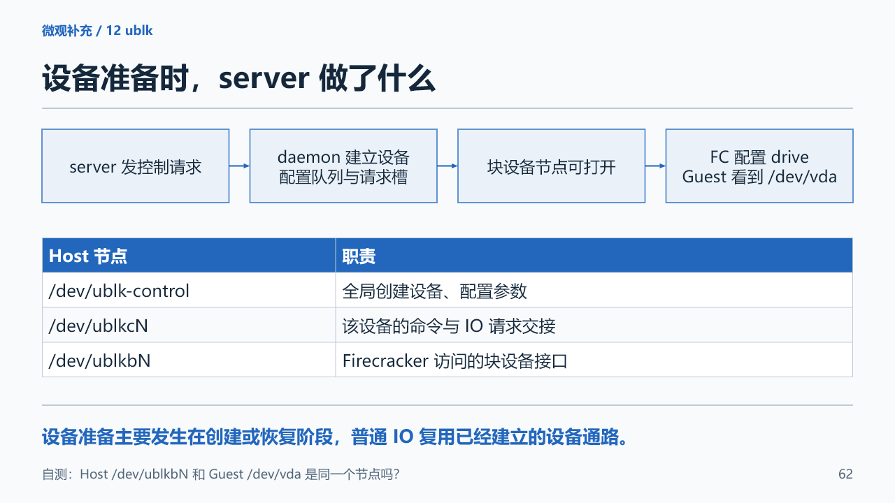

### 就绪检查有不同层次

**API socket 可用、Guest 服务响应、你的工作负载成功需要分别验证。**

start_nowait与wait_for_ready的边界要按具体调用链解释。健康检查是特定协议请求的结果，不自动等价于所有鉴权、业务依赖和冷页均准备好。超时不证明Firecracker退出，需要另行核实与清理。

### 设备准备时，server 做了什么

**设备准备主要发生在创建或恢复阶段，普通 IO 复用已经建立的设备通路。**

固定基线daemon集中管理设备，通过Unix socket接server创建请求。块节点可能已经出现但权限尚未就绪，因此需要确认实际可打开。N是内核分配设备号，不应假设它与某个沙箱编号永久相同。

自测与参考答案

**第16页：健康检查超时，能否直接认为 Firecracker 已退出？**

不能。

**第62页：Host /dev/ublkbN 和 Guest /dev/vda 是同一个节点吗？**

不是。FC把宿主设备作为后端，Guest看到自己的VirtIO块设备。

## 06 控制请求与命令事件流

对应PPT：15、17页。深入阅读：[09-命令执行与事件流](09-命令执行与事件流.md)。

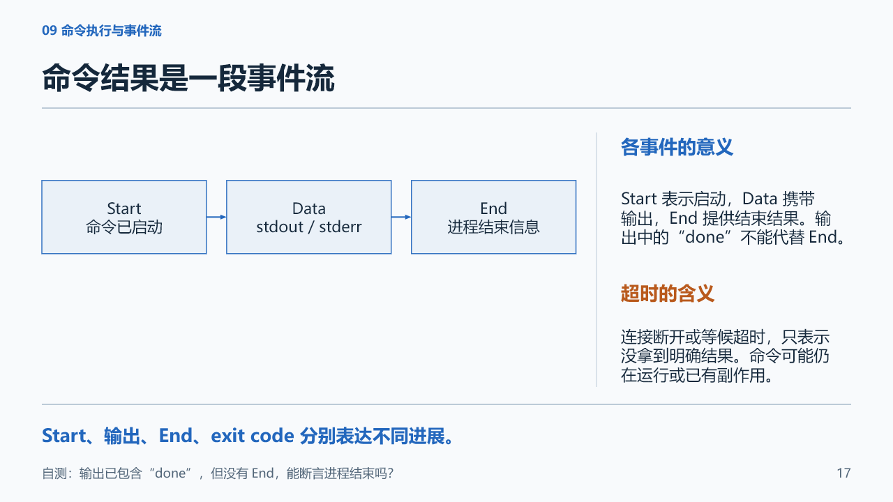

### 控制面如何到达 Guest 命令服务

**API 模块和对象不等于独立进程，socket 连接也不等于业务完成。**

同一server进程内可有多个模块和对象。控制链路存在超时和重试，必须区分请求发出、被接收、动作完成和结果返回。普通文件块读取不需要让每个数据块都穿过orchestrator。

### 命令结果是一段事件流

**Start、输出、End、exit code 分别表达不同进展。**

Guest PID与宿主PID不可混用。收到一段输出不意味着命令结束。请求终止失败也不能推导进程已经结束。即使exit code非零也可能已经产生部分外部副作用。

自测与参考答案

**第15页：构造 EnvdInstance 客户端对象，能证明 Guest envd 可用吗？**

不能，需要实际通信与就绪检查。

**第17页：输出已包含“done”，但没有 End，能断言进程结束吗？**

不能，文本输出不能代替明确的结束结果。

## 07 完整Guest文件读取与SQ/CQ

对应PPT：18、19、20、21、22、64页。深入阅读：[12-ublk与存储daemon](12-ublk与存储daemon.md)。

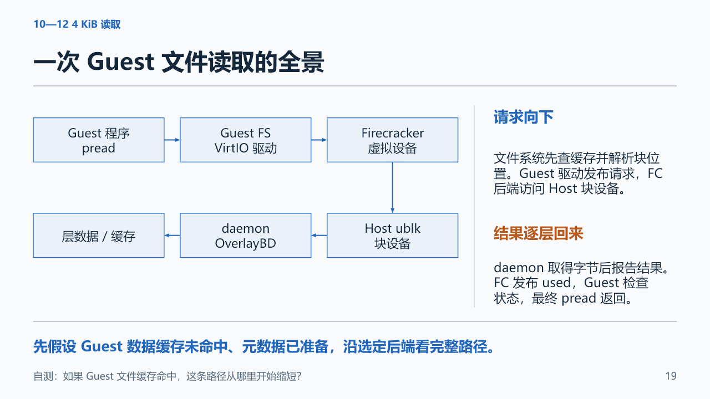

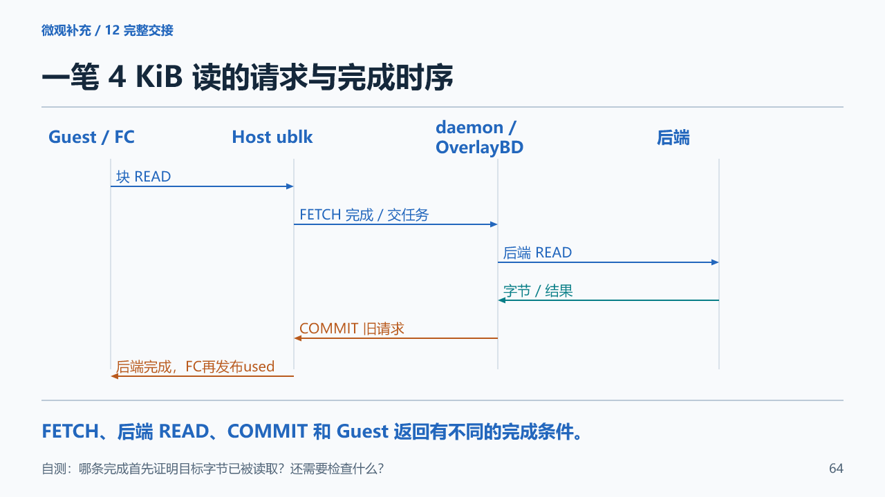

### rootfs、文件名与块地址

**rootfs 是 Guest 挂载为 / 的文件系统，文件偏移与磁盘偏移不同。**

偏移8MiB/40MiB均为教学假设。rootfs不等于RAM，也不等于某个特定镜像文件格式。缓冲写返回、Guest文件系统写回、Host层写出、介质持久化属于不同完成点。

### 一次 Guest 文件读取的全景

**先假设 Guest 数据缓存未命中、元数据已准备，沿选定后端看完整路径。**

上行从左向右，下行从右向左表达请求依赖。server负责前期设备配置，通常不在普通磁盘payload中转路径。缓存命中可能跳过后端段；实际复制方式依实现，不能从流程框数复制次数。

### io_uring 的 SQ、CQ 与 buffer

**CQE 的结果必须对照对应 SQE 的操作解释。**

用户态发布SQ，内核发布CQ；共享环不等于零拷贝或无需系统调用。普通READ CQE的res可为字节数或负错误码，短读需要处理。FETCH是一类请求交接命令，CQE仅说明领取任务完成。

### FETCH 完成的是领取任务

**先接任务，再取得数据，最后报告原块请求完成。**

传统ublk交接模型。daemon为槽位预挂FETCH，内核将操作/位置/长度写入描述区并交任务。READ的完成需另查结果。COMMIT_AND_FETCH可同时提交旧结果并挂接新领取，后续CQE常要等新任务到达。内核版本/模式会改变具体命令。

### 同一笔 IO 的身份与四块 buffer

**请求编号负责关联，buffer 负责字节，各层编号不能互换。**

编号3、qid0/tag7是课堂假设。实际路径可从B经块请求页面及FC中转到G，再由Guest复制给U；不得将示例视为每种模式的固定复制次数。设备状态完成后Guest上层仍需处理。

### 一笔 4 KiB 读的请求与完成时序

**FETCH、后端 READ、COMMIT 和 Guest 返回有不同的完成条件。**

线从上到下表示事件顺序，不按真实时间比例。daemon提前挂FETCH，此图省略预挂步骤。READ后端使用io_uring是选定示例，缓存命中可省略新增后端介质读。Guest驱动检查used与状态，再经FS把字节交用户buffer。

自测与参考答案

**第18页：读文件 offset=0，是否意味着读虚拟磁盘 offset=0？**

不意味着，文件系统会解析到实际块位置。

**第19页：如果 Guest 文件缓存命中，这条路径从哪里开始缩短？**

Guest直接取RAM中的缓存内容，可能不产生该次VirtIO-blk数据读取。

**第20页：所有 CQE 到来，都意味着目标文件数据已读完吗？**

不是，取决于完成的是FETCH、READ、取消还是其他操作。

**第21页：FETCH CQE 到达后，buffer 里必然已有那4 KiB文件内容吗？**

不必然；只是领取完成，后端处理尚需进行。

**第22页：普通磁盘 IO 的 B，和 server 捕获快照的 buffer 是同一个对象吗？**

不是，它们属于不同进程/路径和寿命。

**第64页：哪条完成首先证明目标字节已被读取？还需要检查什么？**

后端READ结果在本例表示读到字节，但要检查错误/短读；Guest用户buffer有效还需后续交付。

## 08 OverlayBD层、索引和零覆盖

对应PPT：23、24页。深入阅读：[11-OverlayBD层与索引](11-OverlayBD层与索引.md)。

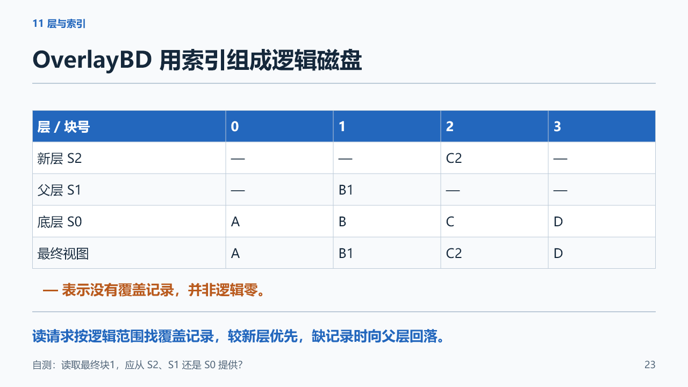

### OverlayBD 用索引组成逻辑磁盘

**读请求按逻辑范围找覆盖记录，较新层优先，缺记录时向父层回落。**

OverlayBD由索引把完整逻辑磁盘范围映射到具体层文件位置。不能将多个层文件直接拼接。一个读取范围可能跨多层/映射段，缓存和压缩后端会改变实际IO。S2视图依赖父层，不能随意删除S1/S0。

### 空洞回落与显式零覆盖

**新状态为零时，需要表达零覆盖，不能用“本层没数据”代替。**

是否有映射、是否显式零、是否驻留是不同属性。空洞在分层视图中可能意味着父层回落，而不是读取零。逻辑位置与压缩层内部位置也不能相互替代。

自测与参考答案

**第23页：读取最终块1，应从 S2、S1 还是 S0 提供？**

S1，因为其B1覆盖底层B，S2没有该范围记录。

**第24页：父层有旧值，当前应为0，直接省略这一段会怎样？**

可能读回父层旧值，形成错误快照/磁盘视图。

## 09 mmap、缺页与COW

对应PPT：25、26、27页。深入阅读：[13-mmap缺页与COW](13-mmap缺页与COW.md)。

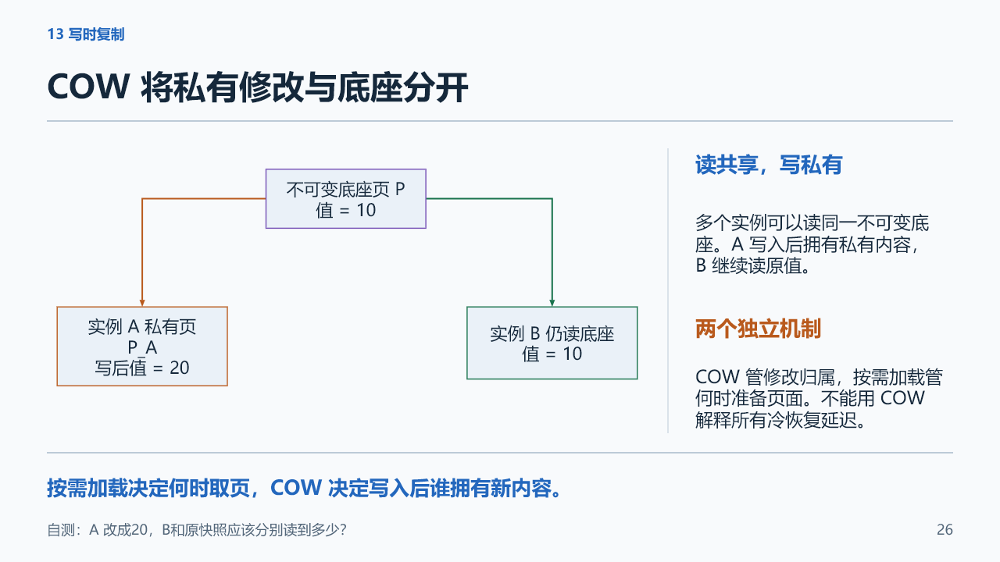

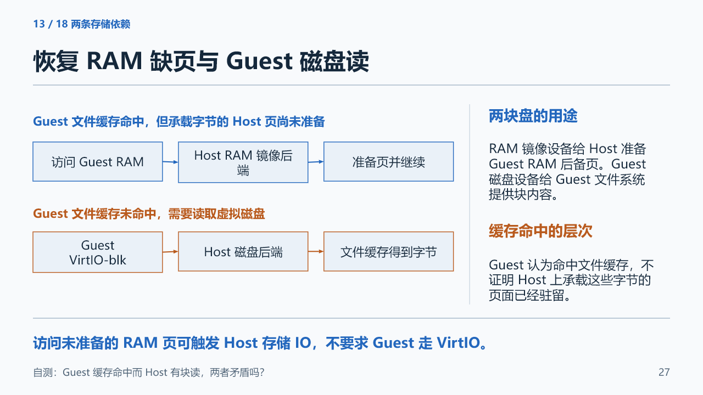

### mmap 建立映射，缺页准备页面

**映射存在，不保证所有页面已驻留，更不保证已读取全部介质数据。**

mmap不是将文件内容一次性复制进内存。缺页的具体处理依映射类型和已有缓存状态。匿名页、文件私有映射和只读块设备模型不能混为一谈。共享/驻留结论必须以具体Firecracker实现及版本核验。

### COW 将私有修改与底座分开

**按需加载决定何时取页，COW 决定写入后谁拥有新内容。**

这是共享页发生私有化的常见COW语义图，非断言每次写都整页复制。已经私有可写的页后续写入通常不用每次复制。AgentENV固定基线架构文档描述只读内存设备私有映射/COW，配套FC底层实现尚待独立审计。

### 恢复 RAM 缺页与 Guest 磁盘读

**访问未准备的 RAM 页可触发 Host 存储 IO，不要求 Guest 走 VirtIO。**

RAM镜像ublk与Guest磁盘ublk用途不同。“Guest缓存命中”只是Guest层视图，不证明承载这些内容的Host页已驻留。Host后端再命中缓存时也可能没有物理介质读。按固定基线文档解释，不绑定未经核验的部署内核映射分支。

自测与参考答案

**第25页：mmap 了2 GiB，是否可以断言已读入2 GiB？**

不能，映射大小不同于实际驻留量和读取量。

**第26页：A 改成20，B和原快照应该分别读到多少？**

未修改的B与原快照仍为10。

**第27页：Guest 缓存命中而 Host 有块读，两者矛盾吗？**

不矛盾，可能是为恢复RAM准备后备页，非Guest磁盘数据读取。

## 10 快照材料、完成边界与一致性

对应PPT：28、29、30、68页。深入阅读：[14-快照状态与一致性](14-快照状态与一致性.md)。

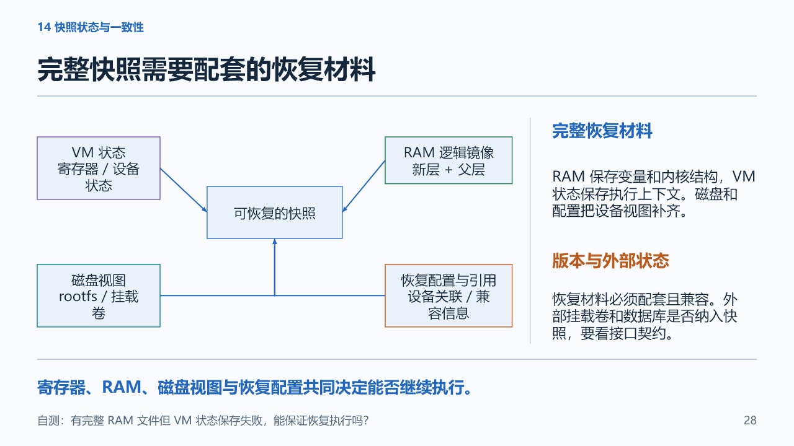

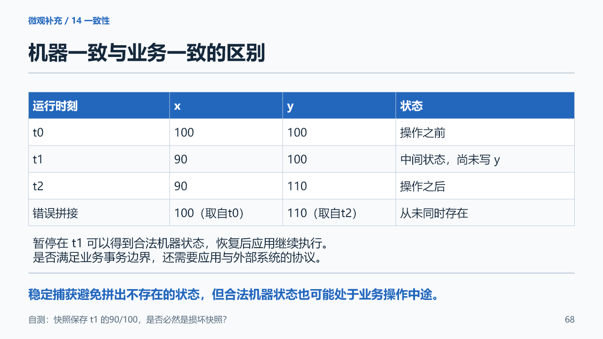

### 完整快照需要配套的恢复材料

**寄存器、RAM、磁盘视图与恢复配置共同决定能否继续执行。**

这是恢复所需材料的概念分组，不是宣称项目manifest恰好有四个文件。仅保存RAM无法提供CPU执行位置和设备上下文。外部挂载卷/数据库是否纳入快照需按契约明确，不因VM暂停就自动一致。

### 暂停、捕获、封存与持久化

**每个完成点只证明本阶段，不能提前报告完整快照成功。**

写保护dirty tracking仅提供写历史，不冻结字节。暂停vCPU只覆盖其执行写入，VMM设备后端仍可能写Guest RAM，必须由整体协议协调。文件格式完成、名字发布与稳定存储确认不同。

### 快照失败后核实三个状态

**请求失败、运行时状态、清理结果要分别记录。**

失败处理需要依据事实决定继续、清理或对账。新恢复实例load失败，不一定破坏旧快照；不能因新实例失败把共享父层一并删掉。清理失败需单列，不可用原请求错误掩盖资源残留。

### 机器一致与业务一致的区别

**稳定捕获避免拼出不存在的状态，但合法机器状态也可能处于业务操作中途。**

数值为教学例。机器一致不是只暂停单个vCPU，还要协调全部相关执行者和设备写入。合法中间态与跨时刻错误拼接不同，不能要求VM快照自动处于每一应用事务的提交点。

自测与参考答案

**第28页：有完整 RAM 文件但 VM 状态保存失败，能保证恢复执行吗？**

不能，寄存器及设备上下文缺失。

**第29页：pause 成功但 RAM 写出失败，能否报告快照成功？**

不能，需要记录快照失败及原运行时状态。

**第30页：恢复请求超时，是否足以断言 VM 根本没恢复？**

不足以，可能动作完成而响应迟到，需要查询真实状态。

**第68页：快照保存 t1 的90/100，是否必然是损坏快照？**

不必然，它可能是合法暂停时刻，应用恢复后继续；业务一致性需另行约定。

## 11 冷热、脏页跟踪与EPT

对应PPT：31、32、33、34、35、65、66页。深入阅读：[15a-冷热页与脏页跟踪](15a-冷热页与脏页跟踪.md)。

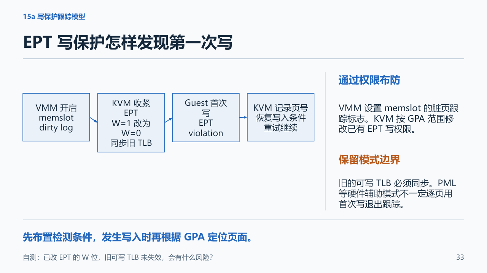

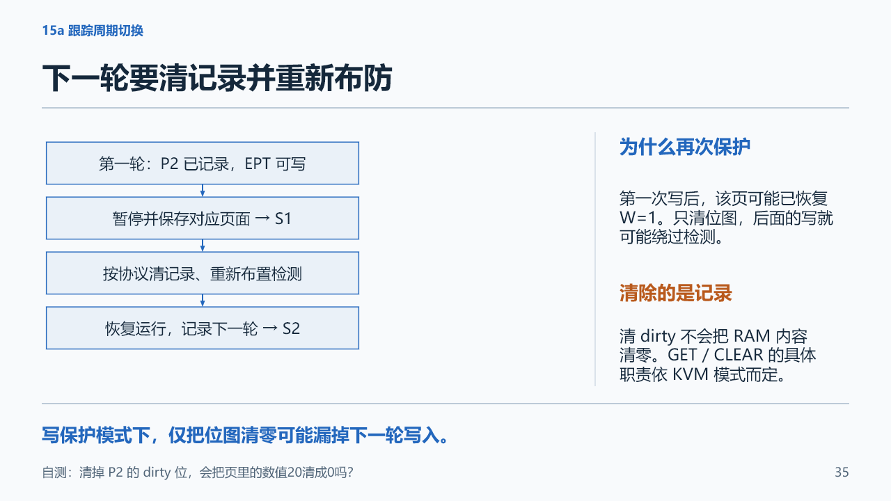

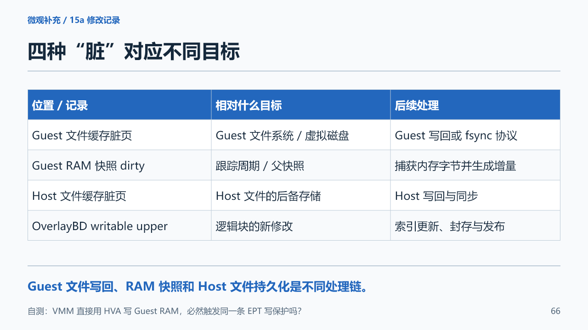

### 冷热、驻留和脏是三个维度

**热度看观察窗口，驻留看当前页面，脏看相对基线的写历史。**

热/冷依时间窗口和采样粒度。Guest文件脏页、RAM快照dirty、Host文件缓存脏页和OverlayBD upper不是同一标记。Accessed位只有访问线索，不直接给精确频率。DAMON/idle tracking在虚拟化场景要验证跟踪后端覆盖，不能简单用FC普通进程访问观测覆盖所有Guest访存。

### 跟踪必须早于要捕获的写入

**事后打开 dirty logging，通常找不回此前没有记录的写历史。**

本页是语义时间线，不能把“创建基准后”死板理解成中间可以遗漏写入。基准稳定、跟踪开始/重置与运行继续之间必须按协议避免缺口。AgentENV配套FC实际enable/reset时序尚未重新审计。

### EPT 写保护怎样发现第一次写

**先布置检测条件，发生写入时再根据 GPA 定位页面。**

以Linux v6.14 x86无硬件dirty辅助的写保护路径解释。VMM设置KVM_MEM_LOG_DIRTY_PAGES，KVM按memslot GFN范围调整已有SPTE，缺失项以后按策略建立。不能裸改W而忽略并发锁和TLB。EPT violation也可能是MMIO/真正只读等其他原因，必须识别。软件设备直接写RAM需要覆盖软件计脏。

### 故障 GPA 怎样定位到位图

**位图记录页身份，页面字节仍需另外读取。**

页大小4KiB及地址为教学例。dirty bit表示该页被记录为写过，不给出写次数、页内字节位置或新内容。保守记录可先于指令重试真正完成，不应把标脏视为新字节已保存。

### 下一轮要清记录并重新布防

**写保护模式下，仅把位图清零可能漏掉下一轮写入。**

KVM GET/CLEAR语义取决于能力和模式。手动保护模式可以把读取与清理重置分开。真实在线跟踪需避免并发写在收集/清理间丢失；本图选暂停协调的教学模型。清标记不会清RAM数据。

### 冷热识别先确定观察窗口

**“最近访问过”不等于精确访问次数，Host 普通进程采样也不必覆盖全部 Guest 访存。**

热度必须定义时间窗口、采样周期、粒度和阈值。只看到Accessed=1不能得出1000次访问。虚拟化下实际硬件访存与普通进程HVA访问路径不同，要验证backend覆盖，不能仅统计FC用户态读写。

### 四种“脏”对应不同目标

**Guest 文件写回、RAM 快照和 Host 文件持久化是不同处理链。**

Guest fsync推进文件到Guest磁盘路径的语义，不会自动清掉RAM相对父快照的dirty。除vCPU写入外，VMM设备后端也可能直接写Guest RAM，需要软件记录覆盖。不能用EPT写保护保证捕捉一切宿主HVA写入。

自测与参考答案

**第31页：读热且干净、冷且脏，能否同时存在？**

可以，两个维度独立。

**第32页：到 pause 时才开始记录，能用它补齐相对旧 S0 的全部变化吗？**

通常不能，没有记录此前的写入历史。

**第33页：已改 EPT 的 W 位，旧可写 TLB 未失效，会有什么风险？**

CPU可能继续用旧权限直接写，绕过本轮检测而漏记。

**第34页：同一页写1000次，位图需要保存1000条记录吗？**

位图通常只需该页一位为1，不表达次数。

**第35页：清掉 P2 的 dirty 位，会把页里的数值20清成0吗？**

不会。标记元数据与实际内容分开。

**第65页：某页在一小时内写过一次、最近一分钟不访问，它可以冷且脏吗？**

可以，热度窗口与dirty基准不同。

**第66页：VMM 直接用 HVA 写 Guest RAM，必然触发同一条 EPT 写保护吗？**

不必然。它走宿主页表，因此需要覆盖宿主设备写入的软件计脏。

## 12 pause捕获、chunk与buffer

对应PPT：36、37、38页。深入阅读：[17-chunk写出与快照封存](17-chunk写出与快照封存.md)。

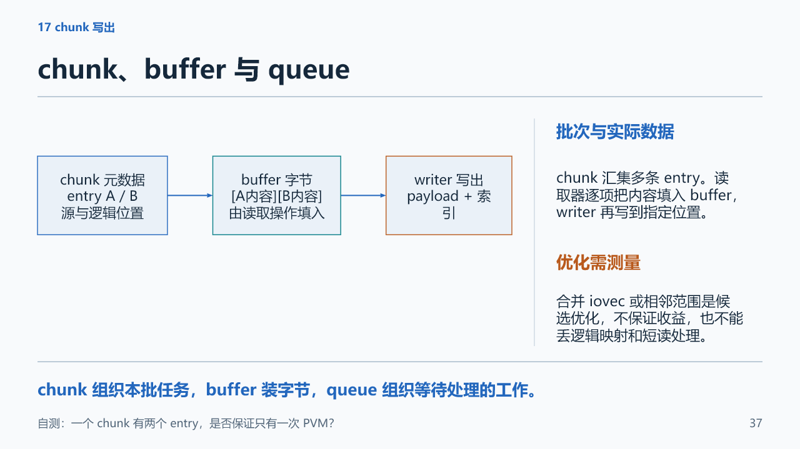

### pause 捕获的三种位置

**源 HVA、RAM 逻辑偏移、server buffer 偏移分别描述不同位置。**

范围消费者将页/区间转为数据读入与输出映射。RAM逻辑位置不是Firecracker HVA，不等于buffer位置，也不等于输出文件实际位置。数据捕获不必先在Guest里形成chunk。

### chunk、buffer 与 queue

**chunk 组织本批任务，buffer 装字节，queue 组织等待处理的工作。**

固定版compact_read_chunk先分配buffer，再顺序遍历entries读取选定source并校验长度。PVM来源一个entry可能因短读多次调用。队列可持有chunk等任务，但chunk本身不是ring或buffer。批量化是优化候选，未实施或实测。

### 紧凑 payload 保留稀疏逻辑位置

**字节放在一起，不代表它们在完整 RAM 镜像中也相邻。**

所有大小为纸面例子，不代表实际buffer_size。源位置普通文件时是源文件offset，ProcessVmReader时是FC HVA。writer索引必须保留各段逻辑位置，否则恢复会把B放错位置或错误补零。并发完成顺序也不能决定最终逻辑顺序。

自测与参考答案

**第36页：获得一份范围列表，是否意味着范围内的字节已经保存在 server？**

没有，需要执行读取。

**第37页：一个 chunk 有两个 entry，是否保证只有一次 PVM？**

不保证，当前按entry读取，且可能短读循环。

**第38页：A/B 紧邻写出后，为什么仍需要两条逻辑映射？**

因为它们对应的RAM逻辑位置不连续。

## 13 层格式、封存与持久化

对应PPT：39页。深入阅读：[17-chunk写出与快照封存](17-chunk写出与快照封存.md)。

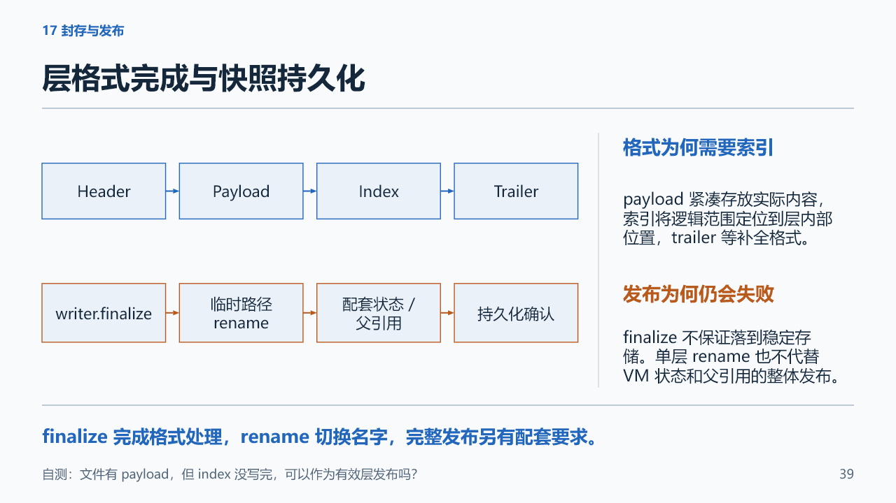

### 层格式完成与快照持久化

**finalize 完成格式处理，rename 切换名字，完整发布另有配套要求。**

图为概念格式，不画压缩封装与对齐细节。源码注释finalize不保证同步到稳定存储。rename原子切名与断电持久性不同。完整快照还需VM状态、RAM层、磁盘层、父引用与manifest配套；具体fsync/远端确认协议按实现检查。

自测与参考答案

**第39页：文件有 payload，但 index 没写完，可以作为有效层发布吗？**

不能，读者可能无法恢复逻辑视图。

## 14 恢复、按需加载与外部状态

对应PPT：40、41、42页。深入阅读：[18-从快照恢复](18-从快照恢复.md)。

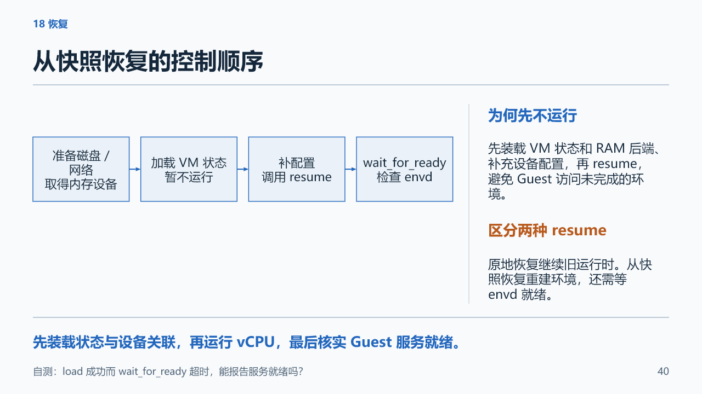

### 从快照恢复的控制顺序

**先装载状态与设备关联，再运行 vCPU，最后核实 Guest 服务就绪。**

固定基线resume_from_snapshot_config经start/start_resume加载快照；普通路径acquire_shared_mem_device，load_snapshot_file指定内存后端和网络覆盖。具体FC映射模式尚待独立核验，按固定文档的私有映射/COW模型讲解，不当作部署实测。

### 恢复成功不等于全部页面已驻留

**冷、热必须说明是哪层缓存；首次访问和预取都可能准备页面。**

按需加载与COW分别决定时间和私有写语义。不能因envd健康检查成功就推导所有RAM页已读回。图中2GiB为假设。实际预取可能使后端IO提前，不应把每次读都归因于Guest首次触碰。

### 快照不会回滚外部世界

**恢复 VM 内部状态，不保证外部连接、租约和副作用仍匹配。**

例子是通用分布式场景，不是AgentENV内置支付功能。TCP对端、Host conntrack/NAT、租约和外部数据库不随Guest RAM回滚。恢复后按协议重连/重新握手，不能把旧连接可用当保证。

自测与参考答案

**第40页：load 成功而 wait_for_ready 超时，能报告服务就绪吗？**

不能，需分别报告装载/运行与服务就绪状态。

**第41页：恢复后第一次访问某页慢，能直接断言读了物理磁盘吗？**

不能，可能是映射、缓存、调度、后端读取等多种工作。

**第42页：VM 状态恢复完整，就能证明外部数据库也恢复到同一时刻吗？**

不能。

## 15 网络包与发送完成

对应PPT：43页。深入阅读：[19-网络包怎样出去](19-网络包怎样出去.md)。

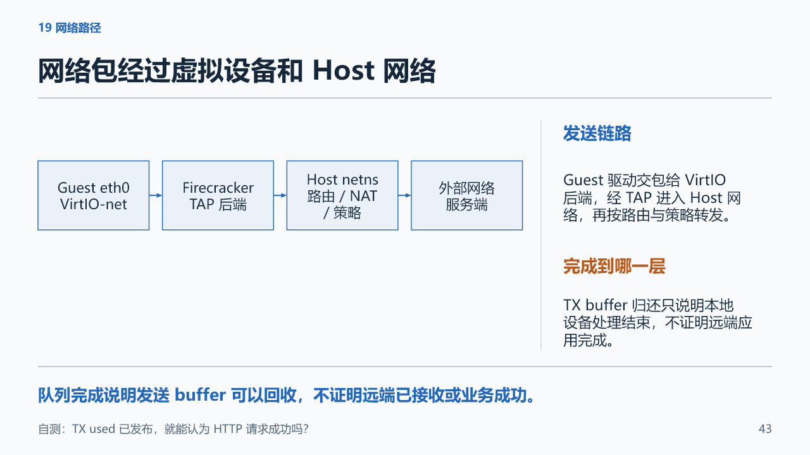

### 网络包经过虚拟设备和 Host 网络

**队列完成说明发送 buffer 可以回收，不证明远端已接收或业务成功。**

本页只画通用关系，不固定项目全部SNAT/DNAT规则或代理覆盖协议。namespace网络视图与访问策略是不同控制。代理能力、TLS SNI可见性及已有连接策略取决于实现，不能当全协议域名防火墙。

自测与参考答案

**第43页：TX used 已发布，就能认为 HTTP 请求成功吗？**

不能，远端接收、协议处理和业务成功是更高层完成点。

## 16 隔离机制的作用对象

对应PPT：44页。深入阅读：[20-各种隔离分别限制什么](20-各种隔离分别限制什么.md)。

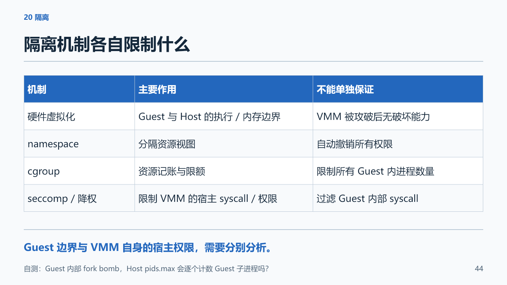

### 隔离机制各自限制什么

**Guest 边界与 VMM 自身的宿主权限，需要分别分析。**

cgroup pids计数宿主task，不直接数Guest进程。内存/CPU等Host资源仍可限制VMM整体用量。seccomp作用于安装过滤器的宿主线程，其覆盖和失败动作须查具体配置，不能概称所有版本trap必杀。namespace不等于降权，chroot也不单独构成完整安全边界。

自测与参考答案

**第44页：Guest 内部 fork bomb，Host pids.max 会逐个计数 Guest 子进程吗？**

不会，Guest进程不是宿主task，仍需Guest内约束及Host整体资源限制。

## 17 资源拥有、回收与寿命

对应PPT：45、46页。深入阅读：[21-资源拥有与回收](21-资源拥有与回收.md)。

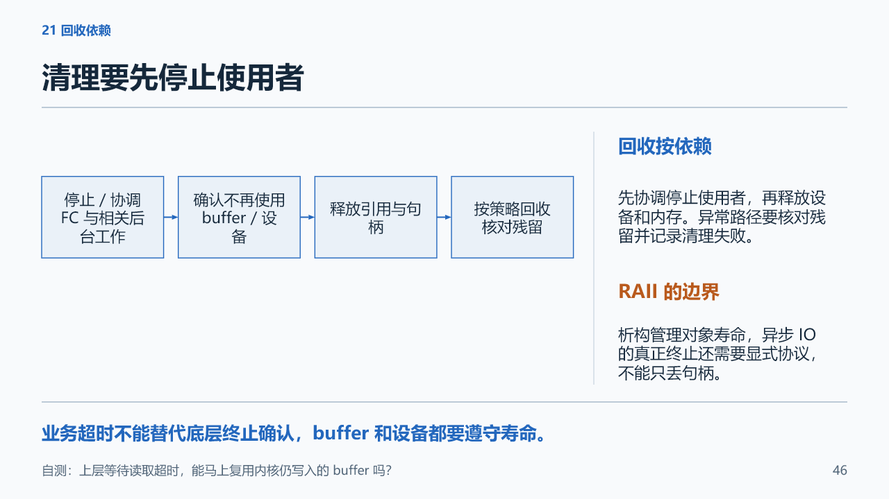

### 资源的拥有者、管理者和使用者

**释放一个句柄，不等于后端资源立即消失。**

共享设备还可能被预取任务等使用。引用归零只是具备回收条件，实际池策略可以保留。server退出不保证独立daemon或内核设备消失，需显式清理和残留对账。

### 清理要先停止使用者

**业务超时不能替代底层终止确认，buffer 和设备都要遵守寿命。**

固定版stop清理存在错误路径和尽力处理，不能把返回成功当成验证所有外部资源消失。停止FC不证明独立DMA或daemon工作终止。多线程和异步资源不能只按创建顺序机械反转，需按实际依赖图。

自测与参考答案

**第45页：删除 A，是否应该立即销毁 B 仍在用的设备？**

不应该。

**第46页：上层等待读取超时，能马上复用内核仍写入的 buffer 吗？**

不能，须确认底层不再访问。

## 18 async、线程阻塞与取消

对应PPT：47、48、67页。深入阅读：[22-async与并发](22-async与并发.md)。

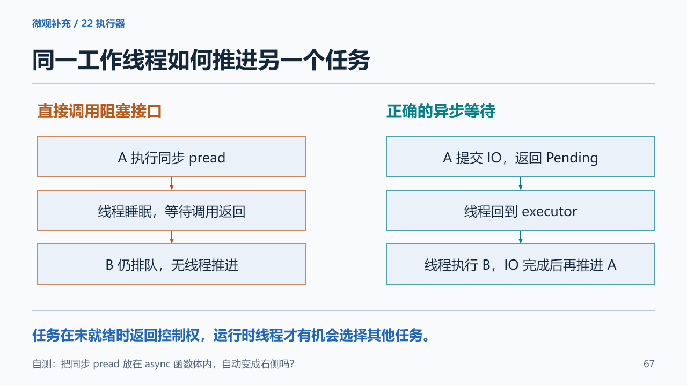

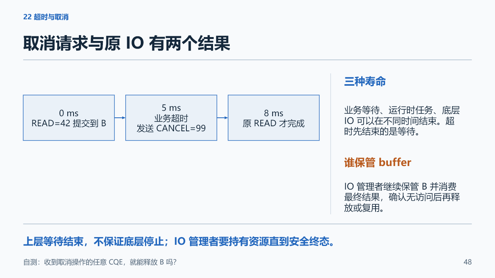

### 阻塞线程与挂起任务的区别

**线程睡眠可让出 CPU，但不能让该线程自动回到运行时推进其他任务。**

async语法不自动将同步PVM/pread改成非阻塞。阻塞期间该线程可能off-CPU，不持续消耗CPU，却仍没有返回executor。运行时可通过真正非阻塞IO或合适blocking池组织；不声称所有runtime都有相同调度策略。

### 取消请求与原 IO 有两个结果

**上层等待结束，不保证底层停止；IO 管理者要持有资源直到安全终态。**

时间为假设，仅限普通单次READ模型。需要依据API终态语义处理取消/正常完成竞态，buffer由在途IO管理者持有。Tokio丢弃JoinHandle可detach，abort不能强中断已开始的spawn_blocking，故句柄丢弃不等于底层取消。

### 同一工作线程如何推进另一个任务

**任务在未就绪时返回控制权，运行时线程才有机会选择其他任务。**

假设唯一运行时worker。右侧需要非阻塞/异步IO以及正确注册唤醒，不是把同步函数加async关键字。阻塞worker时物理CPU仍可执行其他宿主线程，但不能凭空产生第二个executor worker。

自测与参考答案

**第47页：“阻塞”是否意味着一直占着 CPU 忙算？**

不是。它可能睡眠；问题是工作线程尚未回运行时。

**第48页：收到取消操作的任意 CQE，就能释放 B 吗？**

不能，必须确认目标IO终态且不再访问B。

**第67页：把同步 pread 放在 async 函数体内，自动变成右侧吗？**

不会，需要真正让出控制权的等待机制或合适的blocking隔离。

## 19 结果未知、幂等和重试

对应PPT：49、50页。深入阅读：[23-失败与恢复](23-失败与恢复.md)。

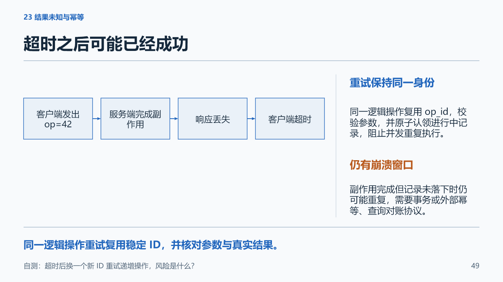

### 超时之后可能已经成功

**同一逻辑操作重试复用稳定 ID，并核对参数与真实结果。**

不能将进行中记录提前写成完成。相同key不同参数要校验。事务、外部服务幂等和对账/补偿用于不同边界；任意shell命令不能只加exec_id就保证所有外部副作用恰好一次。VM回滚也可能回滚去重记录而不回滚外部操作。

### 重试次数与总预算一起限制

**多层独立重试会叠乘，退避与抖动不能替代安全性判断。**

初次+2次重试共3次。对参数/格式错误原样重试通常无效；暂时故障也要满足安全重试条件。固定总deadline，不给每次尝试重置完整预算。等待随机化缓解同步重试，但不解决副作用未知问题。

自测与参考答案

**第49页：超时后换一个新 ID 重试递增操作，风险是什么？**

服务端可能当新操作再次执行，造成重复递增。

**第50页：已用4秒，下一次请求能再单独获得完整5秒吗？**

不能，仍受原总预算约束。

## 20 性能度量与公平实验

对应PPT：51、52、53、54、55、56、57页。深入阅读：[24-性能指标怎样读](24-性能指标怎样读.md)。

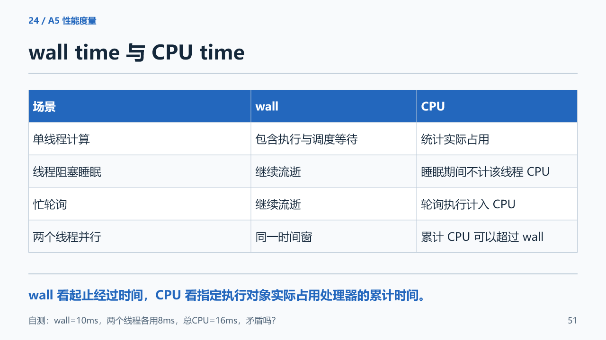

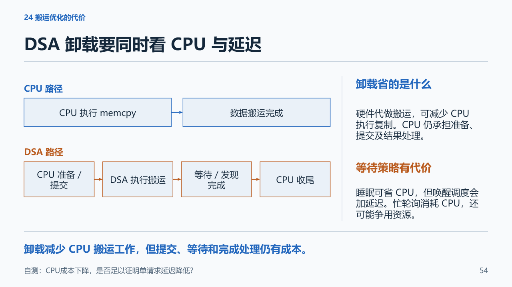

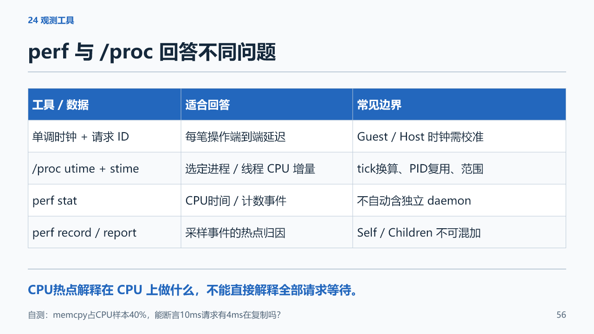

### wall time 与 CPU time

**wall 看起止经过时间，CPU 看指定执行对象实际占用处理器的累计时间。**

只对同一线程同一时间窗，wall-CPU才可近似看作off-CPU。进程范围还含其他线程，跨请求/跨进程不能简单相减得磁盘时间。CPU执行包括执行期间的硬件停顿，并非仅有效指令计算。

### 本地实验：睡眠与忙轮询

**等待时间相近，CPU 成本可以完全不同。**

2026-11-13此前教师本地实测，Windows10.0.26200、Node24.21.0，每组3次。脚本performance.now与process.cpuUsage。计算组CPU略高于wall可受多线程/记账粒度影响，不证明单线程超限。无Linux perf/真实磁盘/Guest测试，无尾分位统计依据。

### 10 ms 请求中的关键路径

**只优化1 ms阶段为0.5 ms，其余不变，总耗时为9.5 ms。**

所有数值为教学假设。局部加速受到关键路径占比限制。异步阶段wall可能与其他工作重叠，需确认是否真的缩短关键路径，不能把并行阶段所有wall相加。

### DSA 卸载要同时看 CPU 与延迟

**卸载减少 CPU 搬运工作，但提交、等待和完成处理仍有成本。**

图为职责图，非具体CPU/IOdie拓扑，不含未测阶段比例。CPU与DSA访问内存的具体路径依硬件型号/NUMA部署。阻塞等待可省CPU但调度可能延迟发现完成，忙轮询计CPU且会争用。真实选择需测相同工作量的端到端wall及所有相关CPU。

### 并发提升容量，也可能增加排队

**到达量持续超过处理能力，无拒绝、取消或扩容时队列会增长。**

600/400为稳定速率教学假设。比较并发vs串行时必须固定到达率和工作负载；并发若将容量从100提升400，确实可比串行少排队，但600仍大于400所以仍不稳定。不能把这两种比较混淆。

### perf 与 /proc 回答不同问题

**CPU热点解释在 CPU 上做什么，不能直接解释全部请求等待。**

proc PID stat14/15是utime/stime，cutime/cstime是已等待回收子进程记账，无对应CPU字段ctime。Firecracker utime已含guest_time，勿重复加。CPU采样40%不等于wall40%；off-CPU等待需要调度/IO时间线等额外证据。

### 公平 A/B 比较的控制条件

**相同工作量、缓存、并发和统计范围，才能解释方案差异。**

A冷缓存并发1与B热缓存并发8不能隔离实现差异。并发批次wall/N不是每请求延迟。若有失败、残留后台任务和快照链增长，必须保留并说明。取中位数时总CPU需逐样本相加再汇总，不能随意把组件中位数相加。

自测与参考答案

**第51页：wall=10ms，两个线程各用8ms，总CPU=16ms，矛盾吗？**

不矛盾，两个线程可并行执行。

**第52页：能用这组三次样本宣称方案的 p99 已改善吗？**

不能，样本与实验目的均不支持。

**第53页：1 ms阶段即使完全消失，总延迟最多下降多少？**

在无其他变化的假设下最多10%。

**第54页：CPU成本下降，是否足以证明单请求延迟降低？**

不足以，需要分别测延迟和CPU。

**第55页：并发16增至64，吞吐不变而延迟上升，多出的请求主要在哪？**

通常更多在排队/等待瓶颈，但需观测定位具体资源。

**第56页：memcpy占CPU样本40%，能断言10ms请求有4ms在复制吗？**

不能，事件、统计范围和wall口径不同。

**第57页：B延迟降低10%但CPU/请求增加40%，能直接宣布更好吗？**

不能，需要延迟、容量、成本目标与资源预算。

## 21 综合推演与下一步

对应PPT：58、59、60、61页。深入阅读：[学习记录](学习记录.md)。

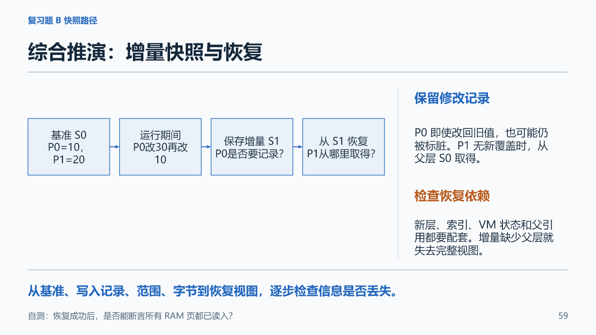

### 综合推演：读取中途失败

**用请求身份和完成条件回答，先区分领取成功与数据读取成功。**

参考答案：FETCH成功仅领取；READ失败不能伪装成功数据。错误经ublk、FC、VirtIO状态传播，Guest最终按实际错误/短读契约结束。Guest缓存命中可免此笔VirtIO读；后端缓存命中可免新增介质读但不必消除整条虚拟设备链。

### 综合推演：增量快照与恢复

**从基准、写入记录、范围、字节到恢复视图，逐步检查信息是否丢失。**

参考答案：P0仍可能dirty，不能仅因字节改回就自动清位；P1若未被新层覆盖则从S0回落。RAM层失败无法发布完整成功快照；父层缺失破坏逻辑视图；仅清位图在写保护模式可能漏下一轮写入。

### 把机制压缩成可核验的表达

**结论、机制、边界、案例用来组织表达，理解仍靠解释因果和预测变式。**

案例可用明确标注的纸面推演，不必冒称实测。五个优先深点不是深度上限，其他主题出现前置缺口时同样深入。缺数字不等于没理解，但不能用未做实验支撑实现性能结论。

### 下一步复习与课程接续

**先复述 dirty 周期与完整读路径，再进入第25课多节点与资源池。**

本轮材料完善不改变独立验收状态。第21—24课已在对话讲解并有局部作答证据，旧状态表需校正为待复习而非未开始。尚待核验：实际配套Firecracker mmap与共享page cache、实际dirty生成/清除时序、具体io_uring接法。

自测与参考答案

**第58页：请分别指出任务描述、实际字节、通知各在哪里。**

描述在virtqueue/ublk描述区/SQ；字节在各层buffer；通知经MMIO/eventfd/完成事件等。

**第59页：恢复成功后，是否能断言所有 RAM 页都已读入？**

不能，按需恢复可只准备已用部分。

**第60页：把这页遮住，用自己的话解释同一个边界。**

关键是区分Guest虚拟设备数据路径与Host准备RAM后备页的路径。

## 来源与版本核对入口

- [固定AgentENV架构文档](https://github.com/kvcache-ai/AgentENV/blob/9f62cbe07cebfecf416dc9bdcf497e2a97687644/docs/src/internals/architecture.md)
- [本地源码索引](源码索引.md)与每课文末的固定提交链接。
- [KVM API](https://docs.kernel.org/virt/kvm/api.html)、[Linux ublk](https://docs.kernel.org/block/ublk.html)、[VirtIO 1.2](https://docs.oasis-open.org/virtio/virtio/v1.2/virtio-v1.2.html)。
- [process_vm_readv](https://man7.org/linux/man-pages/man2/process_vm_readv.2.html)、[io_uring](https://man7.org/linux/man-pages/man7/io_uring.7.html)。
- [实验脚本](实验/24_cpu_wall.cjs)与[原始结果](实验/24_cpu_wall_result.json)。

下一步：先独立解释EPT变更后的TLB同步及新周期重新布防，再复述Guest完整读路径；之后进入第25课多节点与资源池。
